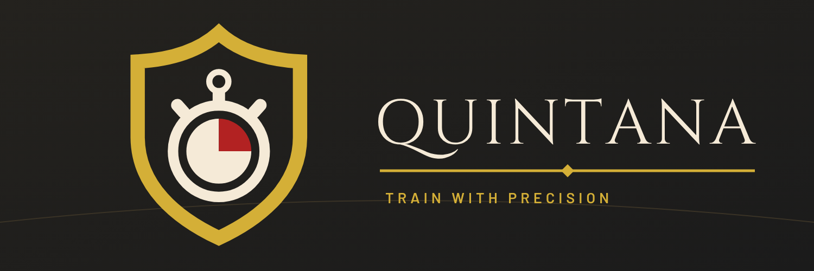

# Quintana brand

A heraldic shield holding a stopwatch: the knight's training in a single sign. A quarter of
the dial is red, the part of the round already run. The name comes from the quintain, the
rotating dummy knights trained on.

## Palette

| Token | Hex | Use |
| --- | --- | --- |
| Charcoal | `#1B1B1B` | Ground of every screen and of the icon |
| Antique gold | `#D4AF37` | The shield, the end of a round, accents, save |
| Ivory | `#F5EAD7` | Text, the stopwatch |
| Deep red | `#B22222` | Only the quarter of the dial in the mark |

The timer phases keep their own, brighter tinctures so iron-colored text on the big buttons stays
readable: workout `#D9442E`, rest `#4C8FD6`, end of a round in antique gold.

## Typography

**Cinzel** for the wordmark and screen titles, **Barlow Condensed** for numbers and labels,
**Barlow** for the rest of the app (all SIL Open Font License). In the SVGs the text is converted
to outlines, so they need no fonts.

## Files

| Asset | File | Use |
| --- | --- | --- |
| Mark | `logo/quintana-mark.svg`, `-mono.svg` | The shield alone; mono for one-color print |
| Logo, dark / light ground | `logo/quintana-logo-dark.svg`, `-light.svg` (+ PNG) | Website, documents |
| App icon | `icon/quintana-app-icon.svg` (rounded), `-square.svg` | Masters; the launcher uses the adaptive icon in `app/src/main/res` |
| Store icon | `icon/quintana-store-icon-512.png` | Play Store listing (512 × 512, Google applies the mask) |
| Splash | `splash/quintana-splash.svg` (+ PNG) | Store graphics; Android 12+ shows the adaptive icon on charcoal instead |
| README banner | `quintana-readme-banner.svg` (+ PNG) | Top of the README, social preview |

All of them, and the app's vector drawables (`logo.xml`, launcher foreground, themed icon,
notification icon), come from one definition of the mark in
[`tools/build_brand.py`](tools/build_brand.py). Change it there and run the script; its
docstring says how. The themed icon and the status bar icon are one color, with the quarter of
the dial left open, and the status bar icon has heavier lines for its small size.
